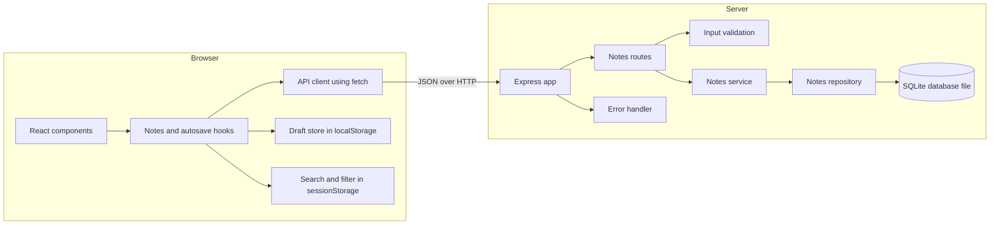
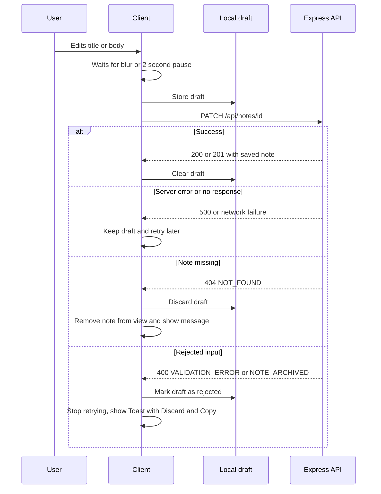
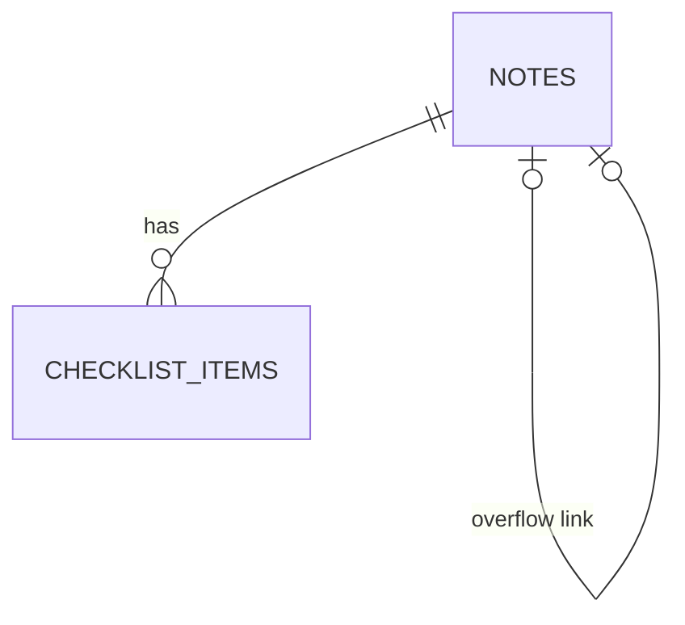

# Architecture: Google Keep Notes (Web)

## 1. Document Info
- **Project:** Google Keep Notes (Web)
- **Version:** 0.7 (applies the design review Section 7.6 resolutions N-01 to N-10, the Section 7.8 clarification N-11, the Section 7.11 Round 3 decisions P-01 to P-09, the Section 7.12 decisions R3-01 to R3-03, and the NFR-08 traceability correction recorded in this version)
- **Date:** 2026-11-16
- **Based on:** `docs/requirements.md` v0.8
- **Status:** Approved by the user on 2026-11-16 (v0.7, "approve the architecture"). v0.5 applied the Round 3 decisions P-01 to P-09 (`docs/design-review.md` Section 7.11, accepted by the user on 2026-11-16, "accept all defaults"). v0.6 applies the Section 7.12 decisions R3-01 to R3-03 (overflow identical-retry order, rejected-draft removal on load, shared save-failed message). v0.7 corrects the NFR-08 mapping: NFR-08 is browser compatibility (requirements v0.8), not a timing check; NFR-01 and NFR-02 remain Playwright timing checks. The Round 3 re-check in `docs/design-review.md` Section 7.13 was accepted by the user as is.

## 2. Confirmed Decisions
| ID | Decision | Source |
|---|---|---|
| D-01 | Client and API run on separate localhost origins on the user's machine (local use only, N-05). Vite serves the client in development; the built client is served from its own localhost origin. Express serves only the REST API, bound to `127.0.0.1`. CORS allows the origin in `CLIENT_URL`. | User answers Q1 (A), Q5 (A), and Q6 (A) |
| D-02 | An overflow note stores `continuedFromId` (on the overflow note) and `continuedInId` (on the original note). | User answer Q2 (B) |
| D-03 | An overflow note that reaches 50 items can create another overflow note, linked from the previous one. | User answer Q3 (A) |
| D-04 | An edit to an archived note returns HTTP 400 with a descriptive JSON error. Only unarchiving is allowed on an archived note. | User answer Q4 (A) |
| D-05 | `continuedFromId` and `continuedInId` on the note, and the exception that a link-only change does not refresh `updatedAt` (FR-13), are an accepted architecture-level addition. `docs/requirements.md` Section 6 does not list them. No requirements change request is raised. | User answer Q7 (B) (N-06) |
| D-06 | Round 3 defaults P-01 to P-09 are applied: overflow idempotency, per-action feedback for non-text changes, archive per note, test environment, Playwright timing checks, draft confirmation on load, checklist replacement in one transaction, and no `HOST` setting. | User decision 2026-11-16 ("accept all defaults"); `docs/design-review.md` Section 7.11 |

## 3. Technology Stack
| Layer | Choice | Traced to |
|---|---|---|
| Client UI | React, Vite, TypeScript, Tailwind CSS | NFR-10 |
| Client tests | Vitest | NFR-11 |
| End-to-end and timing checks | Playwright (browser). Dev dependency; installation needs approval | NFR-01, NFR-02 |
| Browser compatibility check | Playwright on Chromium for the MVP gate; Firefox and Edge are recorded as gaps unless verified (user decision, planning review) | NFR-08 |
| Server | Node.js, Express, TypeScript | NFR-10 |
| Database | SQLite, accessed with `better-sqlite3` (synchronous prepared statements) | NFR-10, FR-12 |
| Server tests | Vitest for unit tests, Supertest for API integration tests | NFR-11 |
| Browser storage | `localStorage` for drafts (FR-12); `sessionStorage` for search and color filter (Section 8 of requirements) | FR-12, Section 8 |

Dependencies are not installed by this document. Installation needs approval under the implementation phase.

## 4. Component Diagram


## 5. Data Flow: Auto-Save With Draft Recovery


## 6. API Design
Base path: `/api`. All bodies are JSON. Timestamps are ISO 8601 UTC strings.

### Note representation
```json
{
  "id": "uuid",
  "title": "string",
  "body": "string",
  "color": "white",
  "checklistItems": [{ "text": "string", "isChecked": false }],
  "isPinned": false,
  "isArchived": false,
  "createdAt": "2026-11-13T10:00:00.000Z",
  "updatedAt": "2026-11-13T10:00:00.000Z",
  "continuedFromId": null,
  "continuedInId": null
}
```

The link fields `continuedFromId` and `continuedInId` are an accepted architecture-level addition (D-05).

### Endpoints
| Method | Path | Purpose | Success | Errors |
|---|---|---|---|---|
| GET | `/api/notes?archived=true` or `/api/notes?archived=false` | List notes in one view. `archived` is required: `true` is the archived view, `false` the active view (N-10). Pinned first, then `updatedAt` descending, then `id`; checklist items are loaded in one query for all returned notes | 200 array | 400, 500 |
| GET | `/api/notes/:id` | Read one note | 200 | 400, 404, 500 |
| POST | `/api/notes` | Create a note. Accepted fields are `id`, `title`, `body`, `color`, and `checklistItems` only; any other field returns 400 (N-04). The client supplies a UUID `id`; server sets timestamps, white default, unpinned and unarchived. A repeated `id` whose content is identical to the stored note returns the stored note (N-01) | 201 note; 200 stored note on identical retry | 400, 500 |
| PATCH | `/api/notes/:id` | Partial update of `title`, `body`, `color`, `isPinned`, `isArchived`, `checklistItems` (full replacement list) | 200 note | 400, 404, 500 |
| DELETE | `/api/notes/:id` | Permanently delete the note and relink its overflow neighbours in one transaction (see Rules) | 204 | 400, 404, 500 |
| POST | `/api/notes/:id/overflow` | Create an overflow note from the 51st item. Request body: `{ "id": uuid, "text": string (0 to 80 characters), "isChecked": boolean }`. `id` is the client-generated UUID of the new note (P-02). The note must have 50 items. An identical retry returns the stored pair (see Rules) | 201 with `note` (new note) and `original` (updated original); 200 with the same body on an identical retry | 400, 404, 500 |

Search and color filtering run in the client over the listed notes, which satisfies NFR-02.

### Rules
- Repeated POST comparison (N-11): compare `title`, `body`, `color`, and `checklistItems` with the stored note after treating an omitted request `color` as `white`. Checklist order is significant: the arrays must have the same length, with matching `text` and `isChecked` values at each position. An otherwise identical retry with omitted `color` matches a stored white note, but not a stored note of another color. Identical content returns the stored note with 200; different content returns 400 `VALIDATION_ERROR` without modifying the stored note (N-01).
- Archived notes: a PATCH that only sets `isArchived: false` unarchives the note and sets `isPinned: false`. Any other PATCH on an archived note returns 400 `NOTE_ARCHIVED`. A PATCH that combines `isArchived: false` with other field changes returns 400 `VALIDATION_ERROR`.
- Archiving: `isArchived: true` on an active note always results in `isPinned: false`, whatever else the request contains.
- Archive is per note (P-03): archiving or unarchiving a note does not change its `continuedFromId` or `continuedInId`. A chain may span the active and archived views. A note opened from a "Continue in new note" link is shown read-only if it is archived (D-04).
- `updatedAt` changes only when a stored field value actually changes (FR-13).
- Overflow: the new note has title `Continued from [original title]`, color white, unpinned, unarchived, and `continuedFromId` set to the original. The original's `continuedInId` is set to the new note's ID. Both changes happen in one transaction. The 50-item limit is checked on the server.
- Overflow title: the original title is truncated so the full overflow title is at most 200 characters. An empty original title gives `Continued from Untitled`.
- Overflow chain: overflow is allowed only on the last note in a chain (`continuedInId` is null), except for the identical retry in the P-02 rule below; otherwise it returns 400 `VALIDATION_ERROR`. Each note's `continuedInId` points to the next note and its `continuedFromId` points to the previous note (D-03).
- The new overflow note contains the item from the request body as its only checklist item.
- Overflow response (N-02): `201` with `{ "note": <new note>, "original": <updated original> }`. The client replaces both notes in its state. When the original has `continuedInId` set, the client replaces the checklist add control with the "Continue in new note" link, so the overflow request is not sent for that note. If such a request arrives anyway and it is not an identical retry (P-02), the server returns 400 `VALIDATION_ERROR` as described above.
- Setting `continuedInId` on the original does not refresh its `updatedAt`, because the link is not user-edited content.
- Overflow on a note that is itself an overflow note follows D-03: the new note links from the previous one.
- Overflow on an archived note returns 400 `NOTE_ARCHIVED`.
- Overflow on a note with fewer than 50 items returns 400 `VALIDATION_ERROR`.
- Overflow idempotency (P-02): the client supplies the new note's `id`, validated as in N-01. The server checks in this order:
  1. If `original.continuedInId` equals `id` and the stored overflow note has the same `text` and `isChecked` at position 0 (N-11 normalization applies), return 200 with `{ "note", "original" }` and change nothing. If `original.continuedInId` equals `id` but the content differs, return 400 `VALIDATION_ERROR`.
  2. If `id` already exists on a note other than the stored overflow note, return 400 `VALIDATION_ERROR`.
  3. If `original.continuedInId` is set to a different ID, return 400 `VALIDATION_ERROR`.
  4. Otherwise apply the overflow rules above and return 201. The archived-note and 50-item checks apply to this step only.
- Delete relinking (N-08, Option 1): deleting a note runs in one transaction. The neighbour links are updated first, and then the note is removed:
  - Middle note (has both `continuedFromId` and `continuedInId`): the previous note's `continuedInId` is set to the next note's ID, and the next note's `continuedFromId` is set to the previous note's ID.
  - Head note (`continuedFromId` is null, `continuedInId` is set): the next note's `continuedFromId` is cleared.
  - Tail note (`continuedInId` is null, `continuedFromId` is set): the previous note's `continuedInId` is cleared.
  - Standalone note: no other note changes.
  - Relinking changes only link fields, so neighbours' `updatedAt` does not change (D-05). The deleted note's checklist items are deleted with it. FR-05 is unchanged.
- A PATCH is atomic: if any field is invalid, the whole request is rejected with 400 and nothing is stored.
- Checklist order is the array order sent by the client; the server stores it in `position`. A checked item keeps its position (FR-11).
- A field counts as changed only when its new value differs from the stored value. Unchanged values in the same PATCH do not count as other field changes.

### Validation (server)
| Field | Rule | Failure |
|---|---|---|
| `title` | string, 0 to 200 characters (counted as code points) | 400 `VALIDATION_ERROR` |
| `body` | string, 0 to 10,000 characters (counted as code points) | 400 `VALIDATION_ERROR` |
| `id` (POST and the overflow request) | UUID format. For POST, if the ID already exists with content identical to the request (`title`, `body`, `color`, `checklistItems`), the stored note is returned with 200 (N-01). For overflow, the P-02 rules apply. Otherwise the request is rejected | 400 `VALIDATION_ERROR` for an invalid format, a conflicting duplicate, or an ID used by another note |
| `color` | one of the preset palette values | 400 `VALIDATION_ERROR` |
| `checklistItems` | array, 0 to 50 items; each text 0 to 80 characters (counted as code points) | 400 `VALIDATION_ERROR` |
| `isPinned`, `isArchived` | boolean; PATCH only, POST rejects them (N-04) | 400 `VALIDATION_ERROR` |
| Unknown fields | Any field not accepted by the endpoint is rejected. POST accepts only `id`, `title`, `body`, `color`, `checklistItems` (N-04), so `isPinned`, `isArchived`, timestamps, `continuedFromId`, and `continuedInId` are rejected | 400 `VALIDATION_ERROR` |
| `archived` (GET query) | Required; exactly `true` or `false`. A missing or other value is rejected (N-10) | 400 `VALIDATION_ERROR` |
| Body size | JSON payload limit of 100 KB | 400 `VALIDATION_ERROR` |

The client truncates checklist text to 80 characters on save and shows a subtle message (FR-11), so the server rejection is a backstop.

### Error format
```json
{ "error": { "code": "NOTE_ARCHIVED", "message": "Archived notes are read-only. Unarchive the note to edit it." } }
```

| HTTP | Code | When |
|---|---|---|
| 400 | `VALIDATION_ERROR` | Invalid input, including malformed JSON, an oversized body, an invalid ID format, a duplicate ID with different content, a field not accepted by the endpoint, and a missing or invalid `archived` query value |
| 400 | `NOTE_ARCHIVED` | Edit to an archived note (D-04) |
| 404 | `NOT_FOUND` | Missing note or unknown route |
| 500 | `INTERNAL_ERROR` | Unexpected server failure; the message does not expose internals |

## 7. Data Schema (SQLite)
```sql
CREATE TABLE notes (
  id               TEXT PRIMARY KEY,
  title            TEXT NOT NULL DEFAULT '' CHECK (length(title) <= 200),
  body             TEXT NOT NULL DEFAULT '' CHECK (length(body) <= 10000),
  color            TEXT NOT NULL DEFAULT 'white',
  is_pinned        INTEGER NOT NULL DEFAULT 0 CHECK (is_pinned IN (0, 1)),
  is_archived      INTEGER NOT NULL DEFAULT 0 CHECK (is_archived IN (0, 1)),
  created_at       TEXT NOT NULL,
  updated_at       TEXT NOT NULL,
  continued_from_id TEXT NULL REFERENCES notes(id) ON DELETE SET NULL,
  continued_in_id   TEXT NULL REFERENCES notes(id) ON DELETE SET NULL
);

CREATE TABLE checklist_items (
  id          INTEGER PRIMARY KEY AUTOINCREMENT,
  note_id     TEXT NOT NULL REFERENCES notes(id) ON DELETE CASCADE,
  position    INTEGER NOT NULL,
  text        TEXT NOT NULL DEFAULT '' CHECK (length(text) <= 80),
  is_checked  INTEGER NOT NULL DEFAULT 0 CHECK (is_checked IN (0, 1)),
  UNIQUE (note_id, position)
);

CREATE INDEX idx_notes_view ON notes (is_archived, is_pinned DESC, updated_at DESC, id);
```

- `PRAGMA foreign_keys = ON` is set on every connection.
- The 50-item limit is enforced in the service layer inside a transaction. SQLite has no simple check constraint for item counts.
- A checklist PATCH deletes the note's existing `checklist_items` rows and inserts the new list in one transaction, so `UNIQUE (note_id, position)` is never violated mid-update (P-08).
- Timestamps are stored as UTC ISO 8601 text.
- The list query uses `ORDER BY is_pinned DESC, updated_at DESC, id` for deterministic order.
- The server validates lengths (counted as code points) before the database; the CHECK constraints are a backstop only.
- `ON DELETE SET NULL` on the link columns is a backstop only (N-08). The service updates the neighbour links before it deletes a note (Section 6), so SET NULL never clears a link that the relink has moved.



## 8. Client Behavior
- **Autosave:** triggers on blur or after a 2-second pause (FR-04). The client sends one save at a time per note and sends the latest state next, so an older response never replaces newer state. Failed saves keep a draft in `localStorage` under a key per note ID, retry on the next edit, on the browser `online` event, and on app load. Rejected drafts (below) are never retried automatically. A draft is cleared only on a 200 or 201 response whose saved content matches the draft (FR-12).
- **New notes:** the client generates the note UUID with `crypto.randomUUID()` when the note is created, so a failed `POST` has a draft key and is retried with the same ID. A retry whose content matches the stored note returns 200 (N-01). A retry with different content returns 400 and is handled as a rejected save. The client runs on `http://localhost` or HTTPS, because `crypto.randomUUID()` is available only in secure contexts (P-06). The NFR-08 browser test checks note creation on that origin.
- **Rejected saves (N-03):** on 400 the client stops retrying and stores the draft with a `rejected` flag. A rejected draft is not replayed automatically, including on load. The `Toast` shows the rejected-save message with two actions: **Discard** removes the draft from `localStorage`, and **Copy** places the draft text (the stored title, body, and checklist item text, as plain text) on the clipboard. A new edit by the user creates a new draft that is sent normally (A-13). See the sequence diagram in Section 5.
- **Overflow drafts (P-02):** the client keeps an overflow request as a pending draft keyed by the original note ID and the new note's UUID. It retries on the same triggers as text drafts, using the latest state of the original note, and clears the draft on 200 or 201. A 400 response is handled as a rejected save (N-03).
- **Draft conflicts (P-07):** each draft records `draftedAt`. On load, a stored draft that is not rejected is compared with the server copy's `updatedAt`. If the server copy is newer than `draftedAt`, the client asks the user to confirm before the draft is applied. Otherwise the draft is applied and saved again. A draft is removed when its note returns 404 or the note is deleted. This replaces last write wins on load for drafts only; concurrent edits still follow A-07. A rejected draft is kept in storage and is not applied or sent; its Discard and Copy actions are shown again (A-13). On load, each rejected draft is checked with `GET /api/notes/:id`, and it is removed if the response is 404 (R3-02).
- **Session state:** search query and selected colors are stored in `sessionStorage` and reset when the browser session ends.
- **Inline editing:** title and body are edited in place within the note card, without a separate page (NFR-05).
- **Rendering:** all note text is rendered as plain text by React. No `dangerouslySetInnerHTML` is used (NFR-03).
- **Checked items (N-09):** a checked item keeps its position, and its row is muted with a line through its text (FR-11). The muted text color is defined per palette color in `client/src/lib/palette.ts`, and each one has a contrast ratio of at least 4.5:1 against that color's note background. Section 11 requires a unit test for every palette color.
- **Time display:** the API returns UTC; the client formats `createdAt` and `updatedAt` in the user's local time zone.
- **Delete confirmation:** deleting opens `ConfirmDialog`, which traps focus and closes on Escape; the DELETE request is sent only after the user confirms (FR-05).
- **Subtle messages:** the `Toast` component, with `aria-live="polite"`, shows the checklist truncation message (FR-11), the note-removed message after a 404 (FR-12), and the rejected-save message with its Discard and Copy actions (N-03). The shared save-failed message (R3-03) reads: "Could not save. Your changes are still shown here; try again." Every "Toast with the save-failed message" cell in the table below uses this text.
- **Expanded view:** `NoteCard` provides the in-place expanded view (FR-02) and renders archived notes read-only (FR-10). When a note's `continuedInId` is set, the checklist add control is replaced by the "Continue in new note" link (N-02).
- **Empty states:** `EmptyState` shows a message when a view has no notes. When search or a color filter matches nothing, it also shows a control that clears both (FR-22).
- **Responsive layout:** Tailwind breakpoints; no fixed widths that force horizontal scrolling (NFR-09).
- **Accessibility:** native buttons and inputs; every icon-only control has an `aria-label` (NFR-06, NFR-07).

**Non-text actions (P-01).** Drafts apply only to title, body, and checklist item text. Other actions are not drafted.

| Action | Send timing | On failure | Feedback |
|---|---|---|---|
| Check or uncheck a checklist item | Immediately | UI reverts to the last saved state | Toast with the save-failed message |
| Add or remove a checklist item | Immediately | UI reverts to the last saved state | Toast with the save-failed message |
| Edit title, body, or checklist item text | On blur or after a 2-second pause (autosave) | Text draft kept | Toast only for a rejected save (N-03) |
| Pin or unpin | Immediately | UI reverts to the last saved state | Toast with the save-failed message |
| Change color | Immediately | UI reverts to the last saved state | Toast with the save-failed message |
| Archive or unarchive | Immediately | UI reverts to the last saved state | Toast with the save-failed message |
| Delete (after confirmation) | Immediately | Note stays in view | Toast with the save-failed message |

## 9. Server Behavior
- Express with JSON body parsing limited to 100 KB.
- Local use only (N-05, user answer Q6 A): the client and the API run on the user's machine. The API always binds to `127.0.0.1`. The MVP has no `HOST` setting, and a non-loopback bind is not supported (P-09). The MVP has no authentication (requirements Section 7), so it is not designed to be exposed on any network. Authentication is a Future item (FR-17).
- CORS allows only the origin in `CLIENT_URL`, which is the local client origin, for example `http://localhost:5173` (an illustrative value, not read from `.env`). Allowed methods are GET, POST, PATCH, DELETE, and OPTIONS. Allowed headers are `Content-Type`. Preflight `OPTIONS` requests are answered with 204 by a small CORS middleware, with no new dependency (N-07).
- API responses carry `X-Content-Type-Options: nosniff` and `Content-Security-Policy: default-src 'none'`, set by a small middleware without a new dependency.
- All SQL uses prepared statements with bound parameters.
- Startup creates the schema if it does not exist, at the path in `DB_PATH`.
- The client supplies note IDs as UUIDs for create and overflow. The server validates the format, returns 200 for an identical retry, and returns 400 for a conflicting duplicate (N-01, P-02).
- The error handler converts known errors to the format in Section 6 and logs unexpected errors on the server only.

## 10. Proposed Folder Structure
```
client/
  src/
    api/              notesApi.ts
    components/       NoteList, NoteCard, NoteEditor, ChecklistEditor, SearchBar, ColorFilter, ColorPicker, EmptyState, ConfirmDialog, Toast
    hooks/            useNotes.ts, useAutoSave.ts, useDrafts.ts
    lib/              palette.ts, limits.ts, time.ts
    styles/           index.css
    App.tsx, main.tsx
  tests/unit/
  tests/e2e/          Playwright checks for NFR-01, NFR-02, and the NFR-08 browser check
  vite.config.ts
server/
  src/
    app.ts            Express app (no listen call)
    server.ts         starts listening on PORT
    config.ts         reads PORT, DB_PATH, CLIENT_URL, NODE_ENV
    db/               database.ts (creates the schema in Section 7), notesRepository.ts
    services/         notesService.ts (rules: archive, overflow, updatedAt)
    routes/           notesRoutes.ts
    validation/       noteValidation.ts
    errors/           AppError.ts, errorHandler.ts
    constants/        palette.ts
  tests/unit/
  tests/integration/  Supertest
```

Environment variable names are `PORT`, `DB_PATH`, `CLIENT_URL`, and `NODE_ENV`. Values come from `.env` and are never written to this document or to the repository. The example URL in Section 9 is illustrative only.

The palette is defined separately in `client/src/lib/palette.ts` and `server/src/constants/palette.ts`, because `client/**` and `server/**` are separate allowlisted paths. A test checks that both lists match.

## 11. Performance Verification
- NFR-01 (P-05): a Playwright test seeds 500 notes, loads the notes list, and measures the time from navigation to the rendered list. This interval is the `GET /api/notes` response time plus client render, and it must be under 1 second. A Supertest integration test that times `GET /api/notes?archived=false` over the same 500 notes is a supporting check only.
- NFR-02 (P-05): a Playwright test seeds 500 notes, types into the search input, and measures the time from the input event to the rendered filtered results, which must be under 300 ms. A unit test of the client filter function is a supporting check only.
- Checked-item contrast (FR-11, N-09): a Vitest unit test in `client/tests/unit` reads every color in `client/src/lib/palette.ts` and checks that its checked-item text color meets a contrast ratio of at least 4.5:1 against that color's note background, using WCAG relative luminance. A palette color without a passing muted color fails the test.
- Test environment (P-04): the API, the SQLite file, and the client run on the same local machine, and the client is served from `localhost`. No network throttling is applied, because the MVP is local-only. The requirements define no separate network or hardware conditions. Each result records the machine, browser, and Node version.

## 12. Out of Scope for This Design
FR-14 to FR-21 (labels, reminders, attachments, accounts, offline sync, collaboration, drag-to-reorder, JSON export) are Future items. Nothing in this design depends on them, and the schema and API have no fields for them.

## 13. Assumptions
- A-01: The palette is white, red, orange, yellow, green, teal, blue, and purple. The exact values are a design choice (requirements Section 8).
- A-02: Validation is hand-written, not a library, to avoid an extra dependency.
- A-03: The SQLite driver is `better-sqlite3`.
- A-04: The overflow note title is a snapshot taken when the overflow note is created.
- A-05: Drafts are retried on the triggers listed in Section 8, with no fixed retry interval.
- A-06: One user and one database file; no authentication (requirements Section 8).
- A-07: Concurrent edits follow last write wins; the MVP has no merge or conflict resolution. On load, drafts are handled by the P-07 rule in Section 8.
- A-08: Overflow notes form a forward chain: each note's `continuedInId` points to the next note and its `continuedFromId` points to the previous note. The "Continue in new note" link on a note follows its `continuedInId`.
- A-09: The MVP has no schema migrations; the schema is created once on startup, and later changes need a separate decision.
- A-10: Only the auto-save flow has a sequence diagram (Section 5). Overflow, archive, and delete flows are defined by the API rules in Section 6.
- A-11: The localhost origin for the built client (the value of `CLIENT_URL`) is a planning-phase detail. This design adds no hosting service and names no host beyond the illustrative origin in Section 9.
- A-12: The implementation plan pins a Node LTS version, and `better-sqlite3` is checked to install on it before implementation (native module).
- A-13: Rejected drafts (N-03) are kept until the user chooses Discard or Copy. Their actions are shown again when the affected note is opened after a reload, and a new user edit creates a new draft that replaces the rejected one. These are architect assumptions, not user-confirmed; the Design Review Agent should check them.

## 14. Open Decisions for Human Review
- O-01: Resolved. The palette in A-01 is adopted (white, red, orange, yellow, green, teal, blue, purple). Exact color values are an implementation choice.
- O-02: Resolved. `better-sqlite3` is adopted (A-03). It is synchronous, needs no server, and fits one user and one database file.
- O-03: Resolved. The overflow title is a snapshot taken at creation (A-04); later renames of the original do not change it.
- O-04: Resolved by user answer Q5 (A). Production also uses separate origins; Express serves only the API and does not serve the client build.
- O-05: Resolved. Last write wins for drafts and concurrent edits (A-07); no merge in the MVP.
- O-06: Resolved. Overflow notes form a forward chain (A-08), replacing the earlier "newest link only" wording.

Resolutions for O-01, O-02, O-03, O-05, and O-06 were made by the architect under the user's instruction to resolve simple items from the baseline. They remain subject to design review and the user's completion approval.

Round 3 (P-01 to P-09): the user accepted all defaults on 2026-11-16. They are applied in Sections 2, 3, 6 to 9, 10, 11, and 15 (D-06). The Design Review Agent re-checks them and closes P-01 to P-09.

## 15. Requirements Traceability
| Requirement | Architecture location |
|---|---|
| FR-01, FR-02 | Notes routes, `notes` and `checklist_items` tables, note representation |
| FR-03, FR-06 | `GET /api/notes` with `archived` true or false, `idx_notes_view`, server ordering |
| FR-04, FR-12 | Section 5 sequence, Section 8 autosave and drafts (draft confirmation on load, P-07) |
| FR-05 | `DELETE /api/notes/:id` and delete relinking (Section 6, N-08) |
| FR-07, FR-09 | Palette, `color` validation, client color filter |
| FR-08 | Client search over listed notes (NFR-02) |
| FR-10 | Archive rules in Section 6 (including P-03) and D-04 |
| FR-11 | Checklist limits, overflow endpoint and idempotency (P-02), D-02 and D-03, muted checked-item contrast (Section 8, Section 11, N-09) |
| FR-13 | `updatedAt` rule in Section 6 |
| FR-22 | Client empty states (Section 8) |
| FR-14 to FR-21 | Out of scope (Section 12) |
| NFR-01, NFR-02 | One list request; client-side filtering; Playwright timing checks in Section 11 (P-05) |
| NFR-03 | Plain-text rendering, prepared statements |
| NFR-09, NFR-06, NFR-07 | Section 8 |
| NFR-04 | No secrets in the repository; `.env` values are excluded (Section 10) |
| NFR-05 | Inline editing in note cards (Section 8) |
| NFR-08 | Latest Chrome, Firefox, and Edge; standard React and CSS (Section 3); note creation on `localhost` or HTTPS (P-06) |
| NFR-11 | Section 3 test tools |
| NFR-12 | Section 6 error format |
